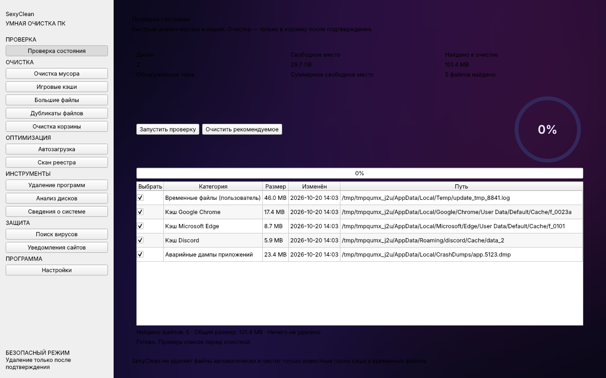

# SexyClean 3.0

Умный и **безопасный** чистильщик Windows в духе CCleaner и других топовых оптимизаторов. Приложение на Python (PySide6); позже собирается в EXE через PyInstaller.



## Запуск
```bat
python -m pip install -r requirements.txt
python sexy_cleaner.py
```

## Сборка EXE
```bat
python -m pip install pyinstaller
python -m PyInstaller --noconfirm --clean --windowed --name "SexyClean" --add-data "assets;assets" sexy_cleaner.py
```

## Возможности

**Проверка состояния (Health Check).** Быстрый анализ рекомендованных категорий мусора (временные файлы, кэши Chrome/Edge/Discord, аварийные дампы) с итоговым размером к освобождению и очисткой в корзину по подтверждению.

**Очистка мусора (Custom Clean).** Категории Windows (временные файлы пользователя и Windows, аварийные дампы, отчёты об ошибках WER, кэш эскизов, недавние документы) и приложений (кэши Chrome, Edge, Firefox, Discord, Steam, NVIDIA, DirectX). Анализ размеров, выбор файлов и перемещение в корзину. Плюс быстрые действия: очистка DNS-кэша и буфера обмена.

**Инструменты.** Удаление программ (список из реестра + запуск штатного деинсталлятора), анализ дисков, сведения о системе (ОС, CPU, ОЗУ, аптайм).

**Оптимизация.** Автозагрузка с обратимым включением/отключением ярлыков из папки пользователя (через резервную папку); чтение ключей автозапуска в реестре.

**Защита.** Запуск быстрого сканирования Microsoft Defender; переход к настройкам уведомлений браузера.

**Прочее.** Поиск больших файлов и точных дубликатов (SHA-256) — только просмотр; очистка корзины с предупреждением.

## Безопасность

- Удаление файлов — только в корзину и только после ручного подтверждения.
- Очистка строго ограничена известными папками кэша и временных файлов; системные и пользовательские каталоги (Windows, Program Files, Документы, Рабочий стол, сохранения игр и т.п.) исключены.
- Реестр и системная автозагрузка **не изменяются**; управление автозагрузкой обратимо и работает только с ярлыками из папки пользователя.
- Большие файлы и дубликаты показываются только для просмотра.
- SexyClean не заменяет антивирус.

> Фон `assets/sexyclean_wallpaper.png` — сгенерированная неоновая заставка по умолчанию; замените файл своим изображением, сохранив имя.
